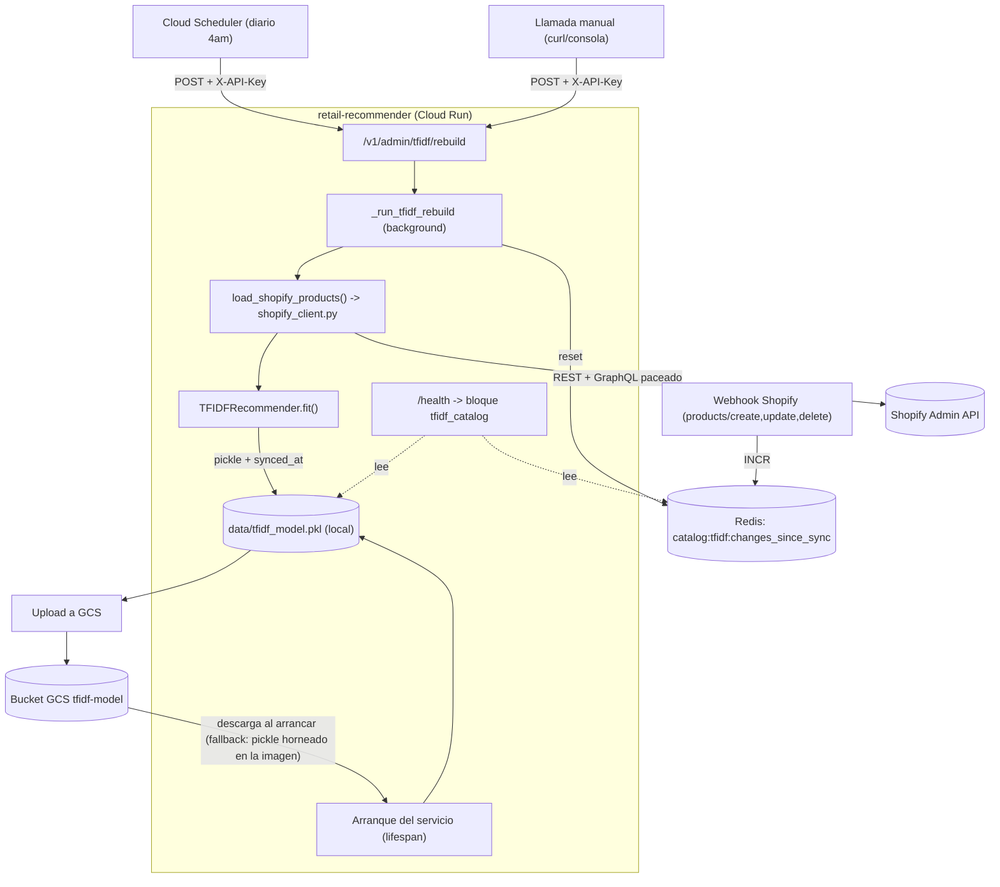

# DCT — Automatización y Monitoreo de Sincronización del Catálogo TF-IDF

**Fecha:** 17–19 de septiembre de 2026
**Origen:** Roadmap corto plazo, `Evaluacion_Integral_Sistema_16092026.md`, sección 14, prioridad #1 — *"Automatizar (o al menos monitorear) la sincronización del catálogo TF-IDF. Es el gap con mayor potencial de degradación silenciosa y ya causó un incidente confirmado."*
**Estado del ítem de roadmap:** ✅ Cerrado y validado en producción con logs reales.
**Nota de alcance:** el roadmap de corto plazo tenía 2 ítems adicionales (auditoría de `requirements.txt`, validación de "Fix 2") que **no** forman parte de este trabajo y siguen pendientes — ver sección "Fuera de alcance" al final.

---

## 1. Resumen ejecutivo (para cualquiera que no vaya a leer el resto)

Antes de esta semana, el catálogo de productos que usa el motor de recomendaciones (TF-IDF) para decidir qué es similar a qué se actualizaba **a mano**: alguien tenía que acordarse de correr un script localmente y luego desplegarlo. Si eso no pasaba durante semanas, un producto podía seguir apareciendo con datos viejos (nombre, categoría, precio) sin que nadie lo notara — de hecho, así fue como se descubrió el problema: persiguiendo un bug de un producto mal recomendado que en realidad ya estaba corregido en Shopify desde hacía meses.

Ahora ese proceso es automático: todos los días a las 4am, el sistema se sincroniza solo con Shopify, sin que nadie tenga que acordarse de nada. Además, cualquiera puede consultar en cualquier momento "¿cuán actualizado está el catálogo ahora mismo?" con una sola llamada al sistema, algo que antes era imposible de saber.

En el camino, encontramos y arreglamos dos problemas de infraestructura que no estaban directamente relacionados con el pedido original, pero que hubieran hecho que la automatización fallara de forma intermitente e impredecible si no se corregían: uno afectaba el rendimiento general del servicio (no solo la sincronización), y el otro hacía que el propio proceso de sincronización chocara innecesariamente contra los límites de la API de Shopify.

---

## 2. Qué hemos implementado

Tres capacidades nuevas, construidas de forma incremental sobre la base ya existente:

### 2.1 Visibilidad del estado del catálogo (monitoreo)
El sistema ahora sabe y puede decir, en cualquier momento, cuándo fue la última vez que se sincronizó con éxito con Shopify, y cuántos cambios de producto se han acumulado desde entonces sin sincronizar.

### 2.2 Sincronización bajo demanda (el "job")
Existe un punto de entrada protegido (`POST /v1/admin/tfidf/rebuild`) que dispara una regeneración completa del catálogo: trae los datos frescos de Shopify, reentrena el motor de recomendaciones, y publica el resultado en un almacenamiento durable (Google Cloud Storage) para que sobreviva a reinicios y despliegues.

### 2.3 Automatización real (Cloud Scheduler)
Un job de Cloud Scheduler llama a ese endpoint todos los días a las 4am automáticamente. Ya se validó una ejecución forzada de punta a punta con éxito; la primera ejecución 100% desatendida está programada para la madrugada del 20 de septiembre.

---

## 3. Qué problema resuelve / qué mejora representa cada pieza

| Pieza | Problema que resuelve |
|---|---|
| Metadata de sincronización (`synced_at`) embebida en el propio modelo | Antes, no había ninguna forma de saber si el catálogo tenía 2 días o 2 meses de antigüedad. El dato ahora vive dentro del artefacto mismo, así que sobrevive a builds y despliegues sin depender de fechas de archivo poco confiables. |
| Contador de cambios pendientes (`changes_since_sync`) | Saber "hace cuántos días" no dice nada sobre "cuántos cambios reales se perdieron". Ahora un vistazo a `/health` distingue "stale pero sin cambios reales" de "stale con 300 productos esperando". |
| Endpoint de rebuild + persistencia en GCS | Antes, la única forma de regenerar el catálogo era correr un script a mano en la laptop del desarrollador y luego desplegar manualmente. Ahora es una llamada HTTP, y el resultado se guarda en un lugar que todas las instancias del servicio pueden leer — no solo la que ejecutó el rebuild. |
| Cloud Scheduler diario | Elimina la dependencia de que una persona se acuerde de hacerlo. El catálogo cambia "unas pocas veces por semana" (confirmado con el negocio) — un ciclo diario es holgado sin ser excesivo. |
| `--no-cpu-throttling` en el servicio | El servicio corría con el modo de facturación por defecto de Cloud Run, que apaga el CPU en cuanto se responde una petición HTTP. Cualquier trabajo que siguiera corriendo en segundo plano después de eso (como el propio rebuild) se congelaba de forma impredecible. Esto afectaba potencialmente a *todo* el servicio, no solo al rebuild. |
| Pacing dinámico + reintentos en el enriquecimiento de precios de Shopify | Al arreglar el punto anterior, el código de precios — que nunca tuvo su propio control de velocidad — empezó a disparar peticiones a Shopify demasiado rápido y a chocar contra el límite de la API en el 86% de los casos. El fix lee el estado real del límite que Shopify ya expone en cada respuesta y se ajusta solo. |

---

## 4. Cambios aplicados (por archivo)

| Archivo | Cambio |
|---|---|
| `src/recommenders/tfidf_recommender.py` | `fit()` graba `synced_at` y `product_count` dentro del pickle; `load()` los lee de forma retrocompatible (pickles antiguos sin esos campos no rompen nada); `health_check()` expone `synced_at` y `days_since_sync`; nuevo método `_days_since_sync()`. |
| `src/api/core/config.py` | Nueva variable `tfidf_sync_max_age_days` (umbral de "desfase", 30 días). |
| `src/api/main_unified_redis.py` | `/health` expone el bloque `tfidf_catalog` (`synced_at`, `days_since_sync`, `stale`, `changes_since_sync`); el arranque descarga el pickle más reciente desde GCS (con reemplazo atómico para evitar corrupción si la descarga se corta a medias) y loguea un WARNING si el catálogo está desfasado; nuevo endpoint `POST /v1/admin/tfidf/rebuild` y su lógica de fondo `_run_tfidf_rebuild()`. |
| `src/api/services/shopify_webhook_handler.py` | `handle_product_event()` incrementa el contador `catalog:tfidf:changes_since_sync` en cada webhook de producto (`create`/`update`/`delete`). |
| `regenerate_tfidf_model.py` (script manual) | Resetea el contador de cambios tras una regeneración local exitosa — sigue funcionando igual que siempre, ahora también alimenta la misma métrica. |
| `src/api/integrations/shopify_client.py` | `get_products_with_shopify_prices()` reescrito: pacing dinámico basado en `extensions.cost.throttleStatus` de Shopify, reintentos con backoff ante `Throttled` (hasta 2 por lote), fallback a REST solo como último recurso. |
| `env-vars.yaml` (nuevo, raíz del repo) | Fuente de verdad versionable de las 35 variables de entorno planas del servicio — creado tras un incidente de despliegue (ver sección 7). |
| Configuración de Cloud Run (`retail-recommender`) | `--no-cpu-throttling` (CPU siempre asignado, en vez de solo durante requests). |
| Infraestructura GCP | Bucket `retail-recommendations-449216-tfidf-model` (GCS); job de Cloud Scheduler `tfidf-daily-rebuild` (diario, 4am). |

---

## 5. Nuevos componentes creados

- **Endpoint `POST /v1/admin/tfidf/rebuild`** — protegido con `X-API-Key`, responde de inmediato y procesa en segundo plano (mismo patrón que el ya existente `POST /v1/mcp/visual-search/index`).
- **Bucket GCS `retail-recommendations-449216-tfidf-model`** — fuente de verdad durable del modelo TF-IDF, con versioning activado.
- **Job de Cloud Scheduler `tfidf-daily-rebuild`** — disparador diario del endpoint anterior.
- **Contador Redis `catalog:tfidf:changes_since_sync`** — señal de "cuántos cambios de producto llegaron desde la última sincronización exitosa".
- **`env-vars.yaml`** — artefacto de configuración versionable para despliegues reproducibles del servicio.

---

## 6. Comunicación y dependencias entre componentes (flujo)

**En palabras:** el disparador (Scheduler o manual) llega al endpoint, que responde de inmediato y sigue trabajando en segundo plano. Ese trabajo trae productos frescos de Shopify (con su propio control de velocidad ahora), reentrena el modelo, lo guarda localmente con su fecha de sincronización embebida, lo sube a GCS, y resetea el contador de cambios pendientes. Por separado, cada vez que el servicio arranca (deploy o cold start), intenta descargar la versión más reciente de GCS antes de servir tráfico — y si no puede, sigue con la que viene incluida en la imagen, sin bloquear el arranque. Los webhooks de productos de Shopify, en paralelo y sin relación con lo anterior, van sumando al contador de "cambios pendientes" cada vez que algo cambia en el catálogo.

---

## 7. Principales problemas encontrados (y por qué importan)

1. **El catálogo TF-IDF vivía desacoplado de Shopify sin ningún mecanismo de sincronización** — el problema original que motivó todo este trabajo.
2. **Incidente de despliegue:** `gcloud run services update --set-env-vars` no es aditivo — reemplaza *todo* el bloque de variables de entorno planas. Al agregar una sola variable nueva (`GCS_BUCKET_NAME`), se borraron sin querer las otras 34 (incluyendo `REDIS_HOST`, `DATABASE_URL`, `SHOPIFY_SHOP_URL`), dejando el servicio en producción degradado durante ~9 horas hasta que se detectó.
3. **Estrangulamiento de CPU (Cloud Run):** el servicio corría en el modo de facturación por defecto, que apaga el CPU apenas se envía la respuesta HTTP. Cualquier trabajo en segundo plano (como el rebuild) quedaba a merced de eso — confirmado con evidencia directa: un ping a Redis que debería tardar milisegundos tardó 140 segundos durante un rebuild.
4. **Tormenta de throttling en la API de Shopify:** al arreglar el problema anterior, el código de enriquecimiento de precios — que nunca tuvo pacing propio — empezó a disparar sus peticiones mucho más rápido, y el 86% de los lotes fueron rechazados por Shopify (`Throttled`), cayendo a un camino de respaldo mucho menos eficiente.
5. **Hallazgo colateral, no resuelto:** mientras se validaba el fix anterior, se detectó que un job de fondo completamente distinto (`PASO 4.6 BG`, enriquecimiento de colecciones, preexistente) compite por el mismo límite de tasa de Shopify al mismo tiempo que el rebuild, sin coordinación entre ambos procesos.

---

## 8. Soluciones aplicadas

1. **Diseño en capas (C → B1 → B2):** primero visibilidad pasiva (metadata + contador), luego el mecanismo de regeneración bajo demanda, luego la persistencia que lo hace sobrevivir a reinicios — cada capa validada en producción antes de construir la siguiente.
2. **`env-vars.yaml` + comando de deploy explícito:** todas las variables planas del servicio ahora viven en un archivo versionable en el repo; el comando de despliegue las declara siempre completas, sin depender de que un ajuste manual anterior "sobreviva".
3. **`--no-cpu-throttling`:** confirmado con documentación oficial de Google Cloud como la causa raíz correcta (no solo un síntoma) antes de aplicarlo. Resultado medido: la duración del rebuild bajó de 625.6s a 38.4s, y el ping de Redis dejó de dispararse a más de 100 segundos.
4. **Pacing dinámico + reintentos en `shopify_client.py`:** el código ahora lee el estado real del límite de Shopify (`extensions.cost.throttleStatus`) en cada respuesta y se autorregula, en vez de depender por accidente de que el CPU estuviera lento. Resultado medido: los fallbacks a REST volvieron de 2625/3045 (86%) a 30/3045 (~1%), al costo de que el rebuild completo ahora tarda ~7-8 minutos en vez de 38 segundos — un costo real y aceptado, no un efecto secundario no deseado.

Cada uno de estos cuatro fixes fue validado con logs reales de producción antes de darlo por cerrado, siguiendo el mismo patrón: hipótesis → evidencia → cambio → nueva evidencia confirmando el cambio.

---

## 9. Gaps y oportunidades de mejora (no resueltos, quedan anotados)

| Gap | Por qué importa | Prioridad sugerida |
|---|---|---|
| Contención de rate-limit entre el rebuild y el job `PASO 4.6 BG` (hallazgo de hoy) | Ambos procesos comparten el mismo presupuesto de la API de Shopify sin coordinarse; cada uno se paceá a ciegas del otro | Media — ninguno de los dos falla hoy, pero es ineficiente y puede empeorar si se agregan más consumidores |
| `requirements.cloudrun.txt` tiene `anthropic>=0.18.0` sin pin | Es el mismo patrón exacto que causó el incidente de producción de julio | Alta — ítem #2 del roadmap original, sigue sin auditar |
| Duración del rebuild diario (~7-8 min) | Aceptable hoy, pero crecerá con el catálogo; hoy se trae el catálogo *completo* cada vez, no solo lo que cambió | Baja por ahora — posible optimización futura (traer solo productos modificados vía los webhooks que ya se están contando) |
| Sin limitador de tasa compartido para *todos* los llamadores a la API de Shopify | Cada pieza de código maneja su propio pacing de forma aislada — el fix de hoy resuelve un llamador, no la arquitectura completa | Media — mejora estructural, no urgente |
| `LFM keep-alive` sigue fallando con error 404 | Preexistente, no investigado en esta sesión, aparece en cada arranque | Baja-media — el fallback a GPT-4o-mini cubre, pero genera ruido en los logs |
| `opm1_visual_sync_no_images_in_catalog` | Warning recurrente tras cada regeneración, causa raíz no investigada | Baja |

---

## 10. Recomendaciones y próximos pasos

1. **Mañana (20/09):** confirmar en `/health` y en logs reales que la primera ejecución **100% automática** del Cloud Scheduler (sin que nadie la dispare a mano) completó con éxito. Es la única validación que falta para cerrar esto del todo.
2. **Retomar el roadmap corto plazo original:** los otros 2 ítems (auditoría de `requirements.txt`, cierre de la validación de "Fix 2") siguen abiertos y no se tocaron en este trabajo.
3. **Cuando se decida abordarlo:** diseñar un limitador de tasa compartido para la API de Shopify, en vez de que cada módulo pacee por su cuenta — resolvería de raíz tanto el hallazgo de hoy como cualquier tercer consumidor futuro.
4. **Optimización futura, no urgente:** evaluar si el rebuild diario puede traer solo los productos marcados como cambiados (via el contador de webhooks) en vez de los 3045 completos, para reducir la duración y la carga sobre la API de Shopify.

---

## 11. Fuera de alcance de este trabajo

Para que quede explícito y no se pierda: el roadmap de corto plazo del documento `Evaluacion_Integral_Sistema_16092026.md` tenía 3 puntos. Este trabajo cierra el punto 1. Los puntos 2 (auditoría de `requirements.txt`) y 3 (validación de "Fix 2" / F-08B.2) **no se tocaron** y siguen pendientes tal como estaban.
