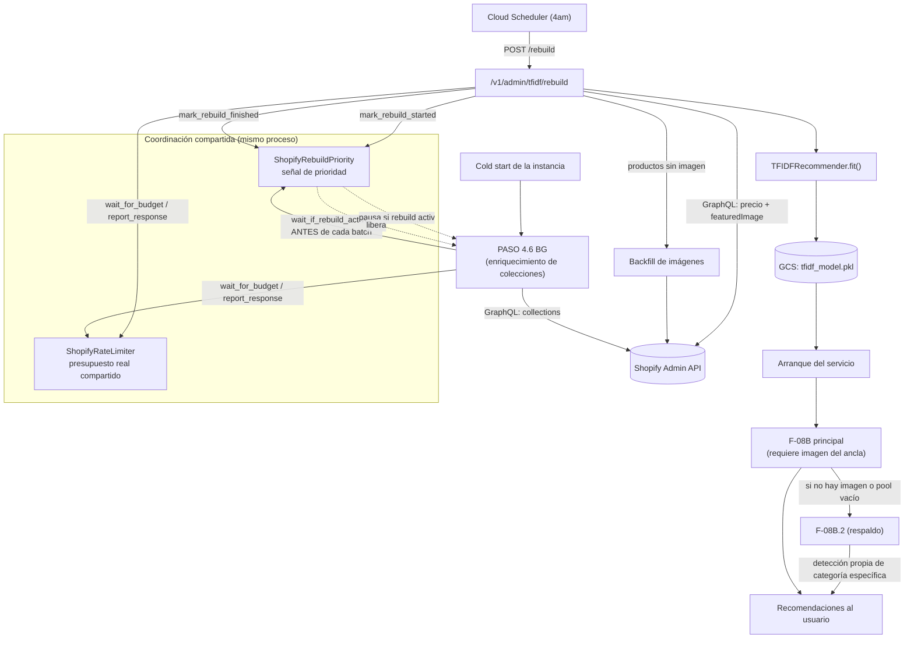

# DCT — Cierre de Fase 1 y Fase 3: Estabilización de Sincronización, F-08B.2 y Contención de Shopify

**Fecha:** 19–24 de septiembre de 2026
**Origen:** `Evaluacion_Integral_Sistema_16092026.md` (roadmap de corto plazo, sección 15) + orden de fases propuesto y acordado en sesión del 22/09/2026 (ver sección 9 de este documento)
**Estado:** Fase 1 (bugs activos) y Fase 3 (arquitectura de soporte — limitador de tasa) **cerradas y validadas con evidencia real**. Fase 2 (unificación de taxonomía) **no iniciada** — ver sección 9.

---

## 1. Resumen ejecutivo

Esta semana se cerró un ciclo completo de trabajo que empezó como una auditoría de dependencias y terminó destapando — y resolviendo — una cadena de cuatro problemas conectados entre sí, algo que no se sabía al principio:

1. Un paquete de Python sin fijar en el archivo de producción real (no en el que todos creían que era el correcto).
2. Un bug donde el sistema de recomendaciones ignoraba la categoría específica que el usuario pedía ("aretes" devolvía collares, brazaletes y más).
3. La causa raíz de ese bug: el 100% del catálogo llevaba semanas sin imagen, por un cambio silencioso de Shopify en su API que nadie había notado.
4. Y, al arreglar eso, dos procesos internos que llevaban meses compitiendo sin saberlo por el mismo cupo de peticiones a Shopify, degradándose mutuamente cada vez que coincidían.

Los cuatro quedan resueltos y confirmados con evidencia de producción — no solo con simulación. El catálogo pasó de 0% de productos con imagen a 99.87%, la categoría específica que pide un usuario ("aretes", "zapatos") ahora se respeta de verdad, y los dos procesos que competían por Shopify ahora se turnan en vez de chocar — confirmado hoy con un resultado de cero fricción bajo el escenario más exigente que se pudo reproducir.

---

## 2. Qué se implementó, y qué problema resuelve cada pieza

### 2.1 — Auditoría de `requirements.txt`

**Problema que resuelve:** el fix del incidente de julio (`anthropic` sin techo de versión) se había aplicado al archivo `requirements.txt` de la raíz del repo — que **no es el archivo que usa el build real** (`Dockerfile.cloudrun` usa `requirements.cloudrun.txt`). El riesgo original seguía intacto en el archivo que de verdad importa, sin que nadie lo supiera.

**Qué se hizo:** se obtuvieron las versiones exactas realmente instaladas en producción (`docker run ... pip freeze`) y se fijaron todas en `requirements.cloudrun.txt` — incluyendo saltos de versión mayores no detectados antes (`anthropic` había avanzado de 0.x a 1.7.0, `openai` de 1.x a 3.16.2, `redis` de 4.x a 8.1.0). Se unificaron los dos archivos (`requirements.txt` ahora incluye a `requirements.cloudrun.txt` en vez de duplicarlo) y se eliminaron 3 archivos de requirements muertos que contenían la misma vulnerabilidad sin pin.

### 2.2 — Imágenes del catálogo TF-IDF (causa raíz + mitigación)

**Problema que resuelve:** `opm1_visual_sync_no_images_in_catalog` — el 100% del catálogo (3045 productos) no tenía `image_url`, bloqueando la búsqueda visual (F-08B) en su totalidad.

**Causa raíz confirmada:** Shopify deprecó el recurso de imágenes de su API REST desde la versión `2025-01` (la que usa este cliente) — documentado oficialmente por Shopify. El fetch masivo de productos seguía usando REST para las imágenes, que ya no las entrega de forma confiable.

**Qué se hizo:**
- Se migró la obtención de imágenes a GraphQL (`featuredImage`), en el mismo batch donde ya se piden los precios — resultado: 2921/3045 con imagen (95.9%) en el primer intento.
- Se agregó una **pasada de backfill**: un segundo intento, más liviano, solo para los productos que quedaron sin imagen tras el lote principal — recuperó la gran mayoría de los restantes.
- Se agregó un **shuffle** del orden de los productos antes de armar los lotes — evidencia real mostró que las pérdidas se concentraban en un tipo de producto (72.6% eran AROS) porque Shopify pagina en orden de creación; desordenar reparte el daño en vez de concentrarlo en una sola colección.
- Resultado final medido: 3041/3045 con imagen (99.87%). Los 4 restantes se verificaron manualmente en Shopify — genuinamente no tienen imagen cargada, no es un problema nuestro.

### 2.3 — Bug de secuencia F-08B.2 (categoría explícita ignorada)

**Problema que resuelve:** consultas como "¿con qué aretes puedo combinar esto?" devolvían una mezcla de accesorios en vez de solo aretes — el sistema ignoraba la categoría específica que el usuario pedía.

**Causa raíz confirmada, en cadena:**
1. `_B08_SHOPIFY_TO_OUTFIT_CAT` (el mapeo de categoría a "bucket" de outfit) estaba definido *dentro* del bloque que requiere una imagen válida del producto ancla.
2. Sin imágenes (ver 2.2), ese bloque principal nunca se ejecutaba — para ningún producto, en ninguna consulta.
3. F-08B.2 (el mecanismo de respaldo) dependía de una variable que solo ese bloque principal calculaba — así que siempre caía a un mapa hardcodeado más tosco, ignorando lo que el usuario pidió.
4. Dos bugs adicionales, descubiertos con evidencia real de producción: (a) cuando la consulta menciona el propio tipo del ancla ("esto aros" con ancla de aros), el sistema lo detectaba como un pedido nuevo en vez de una auto-referencia; (b) una categoría específica y única ("aretes") se mapeaba a su bucket completo (`accessory`) en vez de respetar la especificidad del pedido.

**Qué se hizo:** se corrigieron los 4 puntos de la cadena — en F-08B.2 y, donde fue seguro sin arriesgar código ya probado, también en el bloque principal. Validado con las consultas reales exactas que fallaban, antes y después.

### 2.4 — Limitador de tasa compartido + señal de prioridad

**Problema que resuelve:** dos procesos en background — el rebuild diario del catálogo y el enriquecimiento de colecciones (`PASO 4.6 BG`) — corrían en el mismo proceso sin saber nada el uno del otro, cada uno llevando su propia cuenta del cupo de la API de Shopify. Cuando coincidían, ambos se degradaban: se confirmó con evidencia real un caso con 60 fallos de precio (vs 0 en aislamiento) y el primer fallo permanente de batch visto en semanas.

**Qué se hizo, en dos capas:**
1. **`ShopifyRateLimiter`** — estado compartido del presupuesto real de Shopify; ambos procesos leen y escriben el mismo dato en vez de adivinar cada uno por su cuenta.
2. **`ShopifyRebuildPriority`** — una señal de prioridad: mientras el rebuild usa la API de Shopify, `PASO 4.6 BG` se pausa por completo en vez de competir, y retoma exactamente donde se quedó al terminar el rebuild.

**Resultado validado hoy (24/09/2026), reproduciendo el escenario más exigente (rebuild disparado a mitad del trabajo de `PASO 4.6 BG`):** cero solape entre ambos procesos, `PASO 4.6 BG` pausado por completo durante los ~7 minutos del rebuild, reanudado sin pérdida al terminar, y el rebuild con `REST fallbacks: 0`.

---

## 3. Nuevos componentes creados

| Componente | Ubicación | Propósito |
|---|---|---|
| `ShopifyRateLimiter` | `src/api/integrations/shopify_rate_limiter.py` | Presupuesto compartido del throttling real de Shopify entre procesos |
| `ShopifyRebuildPriority` | mismo archivo | Señal de prioridad — el rebuild tiene precedencia sobre `PASO 4.6 BG` |
| Pasada de backfill de imágenes | `shopify_client.py`, PASO 2.5 | Segundo intento, liviano, para productos sin imagen tras el lote principal |
| Shuffle de productos pre-batch | `shopify_client.py` | Reparte el riesgo de throttling entre tipos de producto |
| `env-vars.yaml` unificado + `requirements.txt` unificado | raíz del repo | Fuentes de verdad únicas, sin divergencia entre archivo "creído correcto" y archivo real |

---

## 4. Representación del pipeline actual

---

## 5. Validación — evidencia real, no solo simulación

| Fecha | Qué se validó | Resultado |
|---|---|---|
| 19-20/09 | Pines de `requirements.cloudrun.txt` | Deploy limpio, sin regresiones atribuibles a los pines |
| 20-22/09 | Imágenes vía GraphQL + backfill + shuffle | 0 → 2921 → 3041/3045 con imagen a lo largo de 3 iteraciones |
| 21-23/09 | Fix de F-08B.2 (auto-referencia + especificidad) | Las 6 consultas reales que fallaban, repetidas, dan el resultado correcto |
| 23/09 | Limitador de tasa compartido, contención real forzada | Coordinación confirmada (logs intercalados de ambos procesos), degradación medida pero acotada |
| 24/09 | Señal de prioridad, mismo escenario forzado de nuevo | **Cero solape** — `PASO 4.6 BG` pausado por completo, `REST fallbacks: 0` |

---

## 6. Problemas encontrados que no estaban en el plan original

Ninguno de estos cuatro problemas fue anticipado en el documento de evaluación del 16/09 — todos se descubrieron investigando la causa raíz del anterior, no por sospecha previa:

1. El fix de `anthropic` de julio nunca llegó al archivo real de producción.
2. Shopify deprecó silenciosamente el recurso de imágenes de su REST API.
3. Ese mismo cambio, sin saberlo nadie, era la causa de un bug de categoría que llevaba semanas reportándose como "raro" sin diagnóstico claro.
4. Dos procesos internos llevaban meses compitiendo por el mismo recurso sin que hubiera evidencia visible de ello hasta que se forzó deliberadamente el escenario.

---

## 7. Gaps y deuda técnica — sin resolver, dicho con la misma honestidad que el documento original

Tomado directamente de `Evaluacion_Integral_Sistema_16092026.md`, sección 13, confirmando cuáles siguen abiertos:

| Ítem del documento original | Estado tras esta fase |
|---|---|
| "La consolidación de taxonomía debería tratarse como incompleta, no como cerrada" | **Sigue exactamente igual.** No se tocó. `_B08_SHOPIFY_TO_OUTFIT_CAT`, `CATEGORY_KEYWORDS` y `_OUTFIT_COMPLEMENT_MAP` siguen siendo 3+ fuentes activas — de hecho, el fix de la sección 2.3 **agregó una cuarta copia temporal** del mismo mapeo (documentada explícitamente como duplicación a resolver, no oculta) |
| "El patrón de bloques gemelos merece una decisión explícita" | Sigue sin decidirse. Esta fase corrigió sus síntomas por tercera y cuarta vez, no la causa |
| "Decidir el destino de `_OUTFIT_COMPLEMENT_MAP` y F-08B.2 en general" | Sin decidir |
| "Sin tests automatizados para F-08/F-08B/F-08C" | Sigue sin existir — cada validación de esta fase fue manual (repetir consultas reales) o simulación ad-hoc, no una suite persistida |
| Inventario/archivados en el catálogo | Diferido explícitamente por decisión de Yasmani (sesión del 22/09), sigue pendiente |
| Redis/Supabase en tier gratuito | Sin tocar |

**Nuevo, de esta fase:**
- El límite conocido del limitador de tasa (memoria de proceso, no Redis) — documentado, aceptado, sin evidencia de que haga falta resolverlo hoy.
- El margen residual de solape entre `PASO 4.6 BG` y el rebuild (acotado a como máximo 1 batch en teoría; 0 en la única medición real hasta ahora).

---

## 8. Recomendaciones

1. No dar por "casi terminada" la consolidación de taxonomía — el propio documento de evaluación ya advertía sobre esto, y esta fase lo confirma con un cuarto caso.
2. Antes de tocar más código en `mcp_conversation_handler.py` (el área con más cambios y más bugs de todo el sistema, según el documento original), escribir al menos los tests automatizados para los escenarios ya reproducidos esta semana — evitaría que la próxima sesión vuelva a validar todo a mano.
3. Seguir observando el limitador de tasa unas semanas más antes de invertir en resolver su margen residual — hoy no hay evidencia de que haga falta.

---

## 9. Estado del roadmap de fases y próximos pasos

| Fase | Estado |
|---|---|
| Fase 1 — Bugs activos (F-08B.2, imágenes) | ✅ Cerrada, validada con evidencia real |
| **Fase 2 — Decisión de unificación de taxonomía + tests automatizados** | ❌ **No iniciada** |
| Fase 3 — Limitador de tasa compartido | ✅ Cerrada, validada con evidencia real |
| Fase 4 — Harness de alpha, inventario/archivados | Sin tocar |
| Fase 5 — T7, infraestructura Redis/Supabase | Sin tocar |

### Próximo paso — Fase 2, con tres piezas concretas ya identificadas

1. **La decisión en sí**: ¿se invierte en unificar F-08/F-08B/F-08C/F-08B.2 detrás de una sola función de "resolución de categoría objetivo", o se acepta formalmente que la taxonomía queda repartida? El documento original ya lo planteaba como pregunta abierta — esta fase aportó evidencia fresca (un cuarto caso del mismo patrón) para decidir con información real.
2. **El script de auditoría por centroides**: revisé el documento de evaluación a fondo y necesito ser honesto — no encontré una especificación técnica detallada de este script en ningún documento local, solo la referencia a que "el backlog ya la prioriza". Lo que sí encontré es su origen: la revisión de Fase 1b (23/07/2026) difirió explícitamente "derivación automática de anclas semánticas por centroide" como trabajo futuro. Antes de poder ejecutarlo, el primer paso real sería diseñar qué mide exactamente ese script (¿centroides de embeddings visuales por tipo de producto, para detectar categorías semánticamente redundantes entre las 3+ fuentes de taxonomía?) — no asumiré el diseño sin confirmarlo contigo.
3. **El destino de `_OUTFIT_COMPLEMENT_MAP` y F-08B.2**: ahora que el camino principal (F-08B) es más robusto que cuando se escribió esa pregunta, es un buen momento para decidir si F-08B.2 reduce su alcance a ser solo la red de seguridad que su nombre sugiere, en vez de mantener un mapa hardcodeado paralelo.

¿Empezamos por la decisión de unificación (punto 1), o prefieres que primero precisemos juntos qué debería medir el script de centroides (punto 2) antes de comprometernos con un rumbo?
